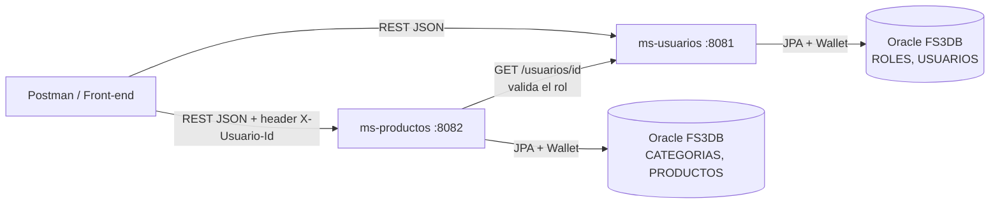
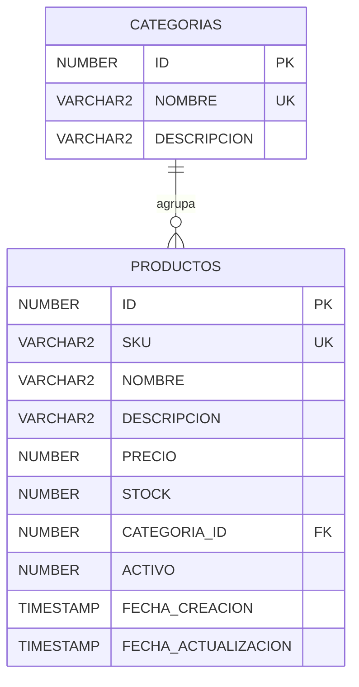

# FS3_Exp1_S2_ms-productos — Tienda en Línea

DSY2205 Desarrollo Full Stack III · Experiencia 1 · Semana 2 — *"Programando nuestro BackEnd"*

**Caso:** Sistema de Gestión de Pedidos de una Tienda en Línea. Se desarrollan 2 de los 3 microservicios, cada uno en su propio repositorio:

| Microservicio | Repositorio | Puerto | Tablas |
|---|---|---|---|
| ms-usuarios | [FS3_Exp1_S2_ms-usuarios](https://github.com/rodolfoulloa/FS3_Exp1_S2_ms-usuarios) | 8081 | `ROLES`, `USUARIOS` |
| **ms-productos** (este) | [FS3_Exp1_S2_ms-productos](https://github.com/rodolfoulloa/FS3_Exp1_S2_ms-productos) | 8082 | `CATEGORIAS`, `PRODUCTOS` |

**ms-productos** se encarga de la gestión de productos (agregar, modificar, eliminar) y sus categorías, además de búsquedas y consultas del catálogo. Está hecho con **Java 21 + Spring Boot 3**, **Spring Data JPA** y **Oracle Autonomous Database (Oracle Cloud)**.

## Arquitectura



- Cada microservicio es una aplicación Spring Boot independiente, con su propio proceso, puerto, repositorio y JAR.
- Ambos usan la base FS3DB de Oracle Cloud, pero **cada uno es dueño de sus tablas**. Para saber el rol de quien gestiona productos, este microservicio consulta a **ms-usuarios** por REST (`UsuarioClient` con `RestClient`). Si ms-usuarios no responde, devuelve 503.

```
src/main/java/cl/duoc/productos/
├── model/        # Categoria, Producto (entidades JPA)
├── repository/   # JpaRepository + consultas JPQL
├── dto/          # ProductoRequest/Response, ResumenCategoriaResponse, UsuarioRemoto
├── client/       # UsuarioClient (RestClient hacia ms-usuarios)
├── service/      # Reglas de negocio + AutorizacionService (roles)
├── controller/   # CategoriaController, ProductoController
├── exception/    # Excepciones + GlobalExceptionHandler
└── config/       # CORS
sql/              # Script de tablas y datos de prueba
postman/          # Colección Postman
```

## Roles y privilegios

| Operación | ADMIN | VENDEDOR | CLIENTE |
|---|:-:|:-:|:-:|
| Consultar y buscar productos y categorías | ✅ | ✅ | ✅ |
| Crear / modificar productos, ajustar stock, activar o desactivar | ✅ | ✅ | ❌ 403 |
| Eliminar productos | ✅ | ❌ 403 | ❌ 403 |
| Crear / modificar / eliminar categorías | ✅ | ❌ 403 | ❌ 403 |

El usuario se identifica con el `id` que devuelve el login de ms-usuarios, enviado en el header **`X-Usuario-Id`**. Sin ese header, las operaciones de gestión responden 400.

> No se implementan medios de pago (según las instrucciones del caso).

## Modelo de datos



Datos iniciales (`sql/02_ms_productos.sql`): **5 categorías** y **8 productos** (precios en CLP).

## Endpoints (`http://localhost:8082`)

| Método | URL | Rol requerido |
|---|---|---|
| GET | `/categorias` | Público |
| GET | `/categorias/{id}` | Público |
| GET | `/categorias/{id}/productos` | Público |
| GET | `/categorias/resumen` | Público. Productos, unidades y valor del inventario por categoría |
| POST | `/categorias` | ADMIN |
| PUT | `/categorias/{id}` | ADMIN |
| DELETE | `/categorias/{id}` | ADMIN (409 si tiene productos) |
| GET | `/productos` | Público. Filtros: `?categoriaId=1`, `?activo=true` |
| GET | `/productos/{id}` | Público |
| GET | `/productos/buscar?q=texto` | Público. Busca en SKU, nombre y descripción |
| GET | `/productos/precio?min=50000&max=300000` | Público. Rango de precios ordenado de menor a mayor |
| GET | `/productos/stock-bajo?umbral=5` | Público. Productos por reponer |
| POST | `/productos` | ADMIN o VENDEDOR |
| PUT | `/productos/{id}` | ADMIN o VENDEDOR |
| PATCH | `/productos/{id}/stock?cantidad=-2` | ADMIN o VENDEDOR. Suma o descuenta unidades (400 si queda negativo) |
| PATCH | `/productos/{id}/estado?activo=false` | ADMIN o VENDEDOR |
| DELETE | `/productos/{id}` | ADMIN |

Ejemplo (`POST /productos` con header `X-Usuario-Id: 2`):

```json
{
  "sku": "MON-LG-001",
  "nombre": "Monitor LG UltraGear 27\"",
  "descripcion": "27 pulgadas, 165 Hz, IPS",
  "precio": 249990,
  "stock": 10,
  "categoriaId": 6
}
```

Todos los errores tienen el mismo formato:

```json
{ "timestamp": "...", "status": 403, "error": "El usuario cperez (rol CLIENTE) no tiene permiso. Roles permitidos: ADMIN, VENDEDOR" }
```

## Buenas prácticas aplicadas

- **Validación** con Bean Validation (`@NotBlank`, `@Positive`, `@Min`, `@Pattern`) en DTOs, con mensajes por campo.
- **Manejo global de excepciones** (`@RestControllerAdvice`): 400, 403, 404, 409, 503 y 500 con formato uniforme.
- **Seguridad:** autorización por **rol** consultando a ms-usuarios, **CORS** restringido y credenciales fuera del repositorio.
- **Logging** con SLF4J de cada cambio (quién lo hizo) y de los accesos denegados.
- **Consultas JPQL** propias: búsqueda por texto, rango de precios, stock bajo y resumen de inventario por categoría (`LEFT JOIN`, `COUNT`, `SUM`).
- **Pruebas** de controladores con MockMvc + Mockito.

## Configuración de Oracle Cloud

1. Copiar el Wallet descomprimido de la base FS3DB en `wallet/`. Está en `.gitignore`, **no se sube**.
2. Ejecutar `sql/02_ms_productos.sql` en **Database Actions → SQL** (*Ejecutar script*).
3. Crear `db-local.properties` en la raíz a partir de `db-local.properties.example` (está en `.gitignore`):

```properties
spring.datasource.url=jdbc:oracle:thin:@fs3db_tp?TNS_ADMIN=C:/proyectos/FS3_Exp1_S2_ms-productos/wallet
spring.datasource.username=ADMIN
spring.datasource.password=tu_clave
```

También se pueden usar las variables de entorno `DB_SERVICE`, `TNS_ADMIN`, `DB_USER`, `DB_PASSWORD` y `USUARIOS_URL` (por defecto `http://localhost:8081`).

## Ejecutar

Primero levantar **ms-usuarios** (puerto 8081) y luego este microservicio:

```powershell
.\mvnw.cmd spring-boot:run
```

## Pruebas

**Postman:** importar `postman/ms-productos.postman_collection.json` y ejecutarla con *Run collection* (28 solicitudes con aserciones). La carpeta *Preparación* inicia sesión en ms-usuarios con ADMIN, VENDEDOR y CLIENTE y guarda sus IDs para el header `X-Usuario-Id`. La colección crea, modifica y elimina sus propios registros, así que se puede repetir.

**Pruebas unitarias** (no requieren Oracle ni ms-usuarios):

```powershell
.\mvnw.cmd test
```
